<p align="center">
  <a href="https://imgm.app">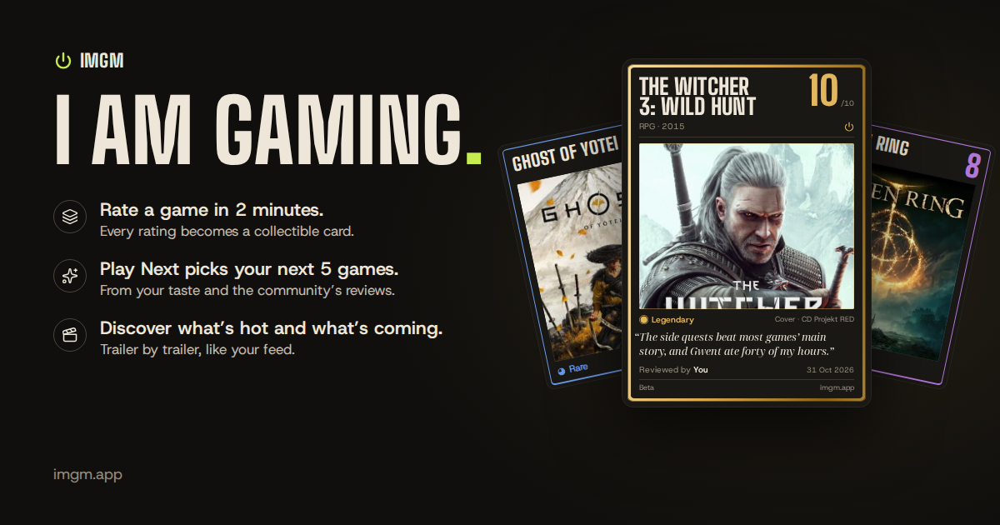</a>
</p>

<h3 align="center">Play it. Rate it. Collect it.</h3>

<p align="center">
  A game review site where every review is a quick quest, every score is loot,<br>
  and an AI agent picks the next five games you'll actually want to play.
</p>

<p align="center">
  <a href="https://imgm.app"></a>
  
  <a href="LICENSE.md"></a>
</p>

<p align="center">
  
  
  
  
  
  
  
  
  
</p>

<p align="center">
  <a href="#rate-a-game-in-two-minutes">Features</a> ·
  <a href="#guess-the-game-every-day">Daily game</a> ·
  <a href="#play-next-the-ai-agent">Play Next</a> ·
  <a href="#under-the-hood">Under the hood</a> ·
  <a href="#run-it-locally">Run it locally</a>
</p>

---

## Rate a game in two minutes

<table>
  <tr>
    <td width="40%" align="center">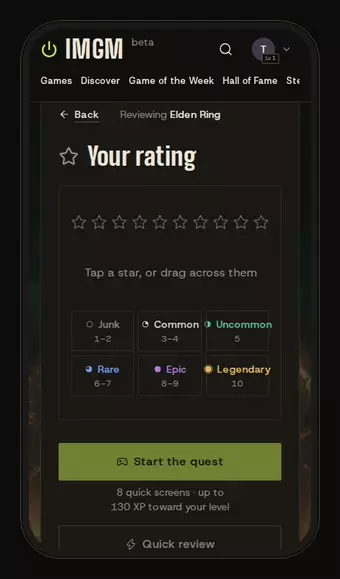</td>
    <td>
      <p>A review on IMGM isn't a form. It's a <b>quest</b>: nine quick screens, and only the rating is required.</p>
      <ul>
        <li><b>Your rating:</b> tap or drag across ten stars.</li>
        <li><b>Your setup:</b> platform, hours, finished or still playing, solo or co-op.</li>
        <li><b>The vibe:</b> cozy, chaotic, atmospheric, rage-inducing…</li>
        <li><b>When did it get good?</b> Instantly, after a few hours, or never.</li>
        <li><b>The checklist:</b> graphics, gameplay, audio, story, difficulty, grind, length, bugs, PC specs, price and replay, in plain words like <i>"One more match" (it's 4 AM)</i>.</li>
        <li><b>It's like ___ meets ___</b>, pros and cons, best and worst moment, and final words.</li>
      </ul>
      <p>Every screen earns XP toward your level, and reviews unlock badges. In a hurry? <b>Quick review</b> is just the score.</p>
    </td>
  </tr>
</table>

## Every rating becomes a collectible card

<table>
  <tr>
    <td>
      <p>Your score sets the card's <b>rarity</b>, from a grey Junk card to a gold Legendary one:</p>
      <p>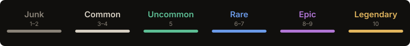</p>
      <ul>
        <li>The card tilts toward your pointer, with a soft glare across it.</li>
        <li><b>Flip it</b> and its back is the verdict: every checklist answer on a meter in the rarity colours.</li>
        <li>Pick the art from the game's covers and screenshots, then <b>share</b> it as a picture.</li>
        <li>A game's IMGM score is its players' average, with the same rarity.</li>
      </ul>
    </td>
    <td width="40%" align="center">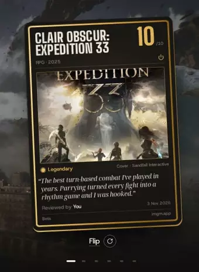</td>
  </tr>
</table>

## Discover: what's hot and what's coming, trailer by trailer

<table>
  <tr>
    <td width="40%" align="center">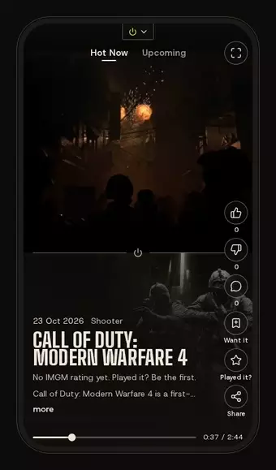</td>
    <td>
      <p>A feed like the ones on your phone, but every screen is a game. <b>Hot Now</b> is the most visited games of the last two years; <b>Upcoming</b> is the most wanted games of the next year, ranked by IGDB's popularity data.</p>
      <ul>
        <li><b>Trailers without ads:</b> streamed from Steam's own video servers, then Xbox's, and YouTube only as the last resort.</li>
        <li>Thumbs up or down, <b>comments</b> with replies and likes, <b>Want it</b> for your backlog, and <b>Played it?</b> for a one-tap score.</li>
        <li>Sound like Reels: it starts muted, and one tap turns it on for the whole feed.</li>
        <li>Built for phones: square trailers upright, full screen on its side.</li>
      </ul>
    </td>
  </tr>
</table>

<p align="center">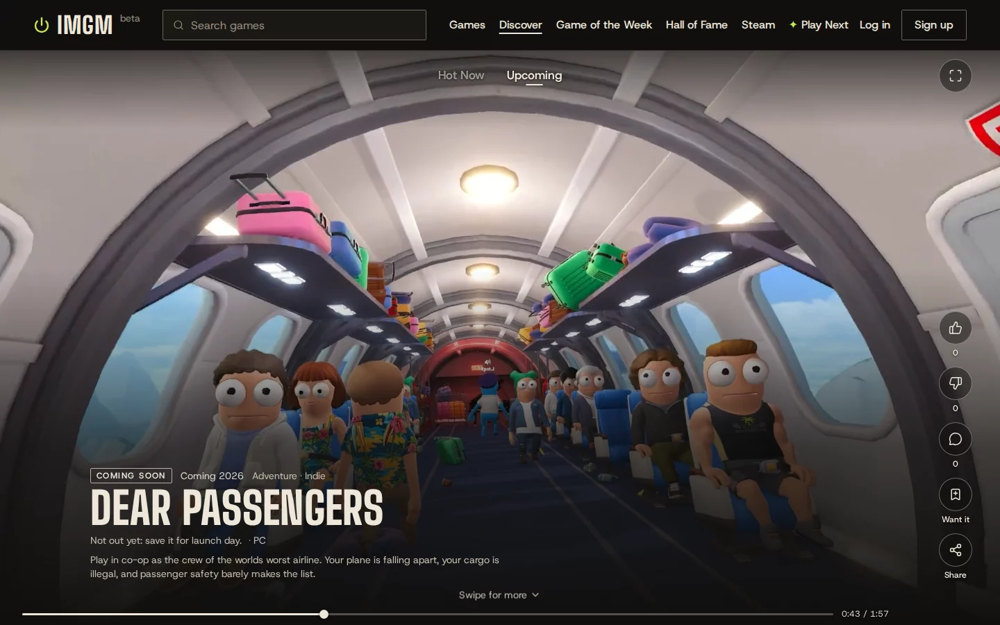</p>

## Guess the game, every day

<table>
  <tr>
    <td>
      <p>One game a day, the same for everyone: guess it from a blurred screenshot in six tries.</p>
      <ul>
        <li><b>Clearer with every miss:</b> each screenshot gets two tries, sharper the second time, then a new one comes in.</li>
        <li><b>Clues as you go:</b> the genre, the year, <b>a line from the game</b>, the studio, and on the last try a blurred moment of its trailer.</li>
        <li><b>How close was it?</b> Every guess says Cold, Warm, Hot or So close, with tiles for genre, year, studio and series.</li>
        <li><b>Skip</b> a try for the next picture and clue. Streaks, today's results, and a <b>share picture</b> that never shows the answer.</li>
      </ul>
    </td>
    <td width="55%" align="center">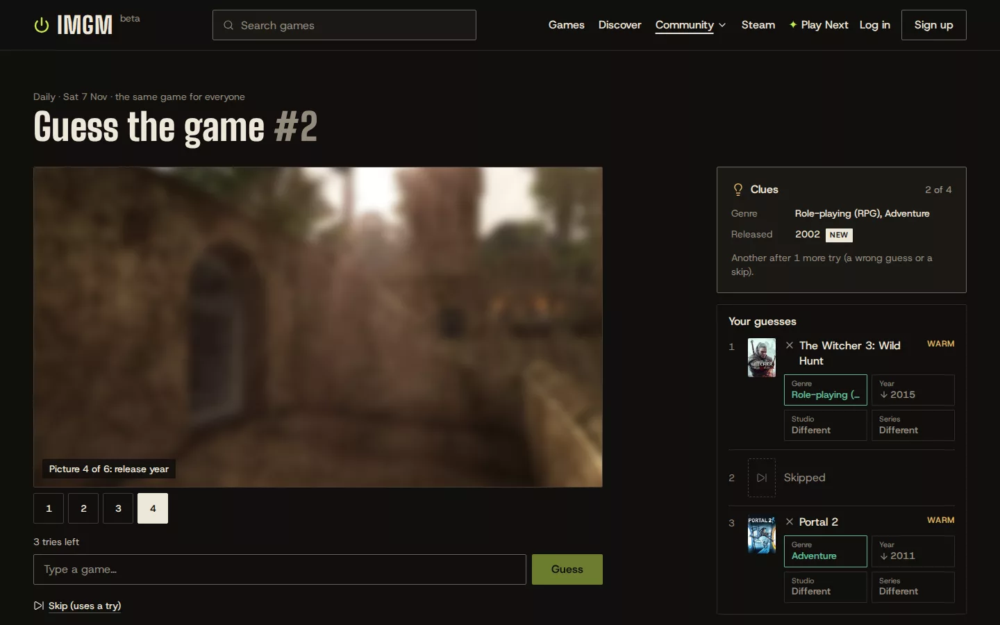</td>
  </tr>
</table>

## Play Next: the AI agent

Tell Play Next what you're in the mood for (*"something cozy for a rainy evening"*, *"games like Hades but longer"*) and it picks **five games for you**. It reads your own reviews and what IMGM players say about each game, and it checks its own answer before you see it.

It's a **LangGraph** agent in Python, with its own tools:

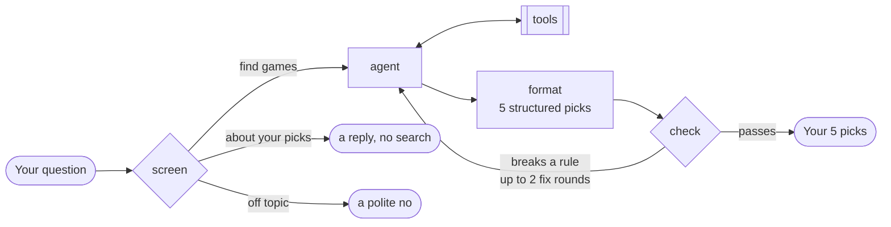

| Tool | What it does |
|---|---|
| `get_my_taste` | Your reviews: what you loved, what you didn't, the vibes you pick. |
| `search_imgm_reviews` | Searches every IMGM review by meaning (RAG over **pgvector**). |
| `search_games` | Searches IGDB's catalogue through the IMGM server. |
| `get_game_profile` | What IMGM players think of one game: its score, top vibes, when it gets good, the checklist verdicts. |
| `get_game_family` | A game's series, its studio's games that play like it, and similar games, so new releases aren't missed. |
| `search_web` | A web search (Tavily) for what's too new for the rest, at most twice an answer. |
| `get_my_steam_games` | Your Steam hours: the games you love (many hours), the ones that didn't click, and the ones you own but never played. |

**The prompt asks, the code enforces.** Every hard rule lives in plain Python in [`check_answer()`](imgm-ai/src/imgm_ai/agent/nodes.py): five different games, each one found by a real search, nothing you've already reviewed or turned down, playable on your platforms, no longer than you asked for, never the game you named, at most one from its series, and exactly one Best Pick. A broken rule sends the draft back to the agent to fix. The agent never sees your user id as something it could change: its tools read it from the graph's config, so a prompt injection can't make it look at someone else's reviews.

**Your Steam hours, your rules.** Connect Steam and a small menu decides what Play Next may do with your library: use it at all, recommend games you've already played (only under 2, 5, 10 or 20 hours, or with no limit to replay a favourite), and at most how many of the five picks may come from it. The menu travels in the graph's config like your id, and one function decides what's allowed: the tool tells the model with it, and the check enforces it with it, so the two can't disagree. A pick from your library says so on its card, with your hours.

Each message is screened first by **Jev** (TypeSafe), a fast classifier, in about 0.2s: find games, talk about the picks, or politely decline. Gemini decides when Jev isn't sure.

The answer comes as **shelves**: your five picks and a few honorable mentions, grouped by what you'd want from them, and *If you only play one* at the end. Then you **sort your picks**: mark the ones you've played or don't want, and one search replaces just those.

## And the rest of IMGM

<p align="center">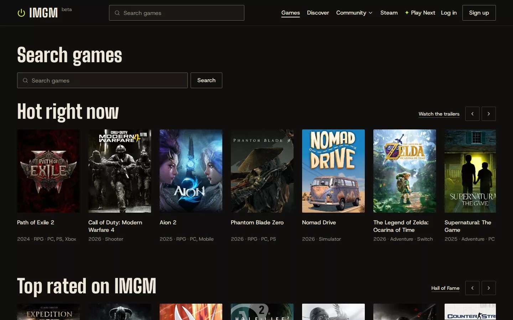</p>
<p align="center"><b>Games</b>: search as you type (a title typed halfway still finds it), then shelves: hot right now, top rated on IMGM, coming soon, just reviewed, and picked for you.</p>

<table>
  <tr>
    <td width="50%">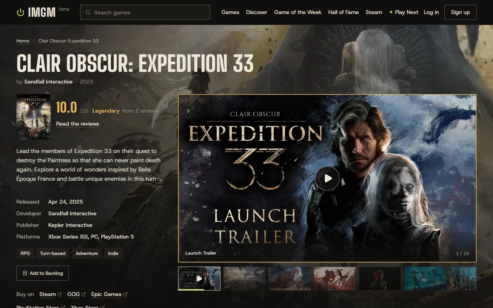<p align="center"><b>Game pages</b>: trailers and screenshots, the IMGM score, an AI summary of what players praise and criticize, and where to buy.</p></td>
    <td width="50%">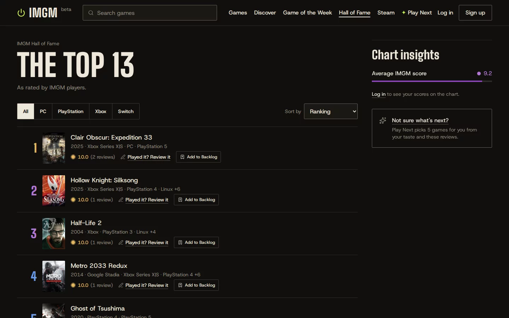<p align="center"><b>Hall of Fame</b>: the best-rated games on IMGM, by platform.</p></td>
  </tr>
  <tr>
    <td width="50%">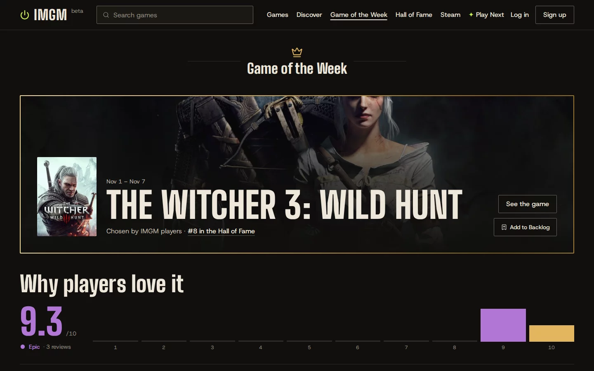<p align="center"><b>Game of the Week</b>: chosen by the community every week.</p></td>
    <td width="50%">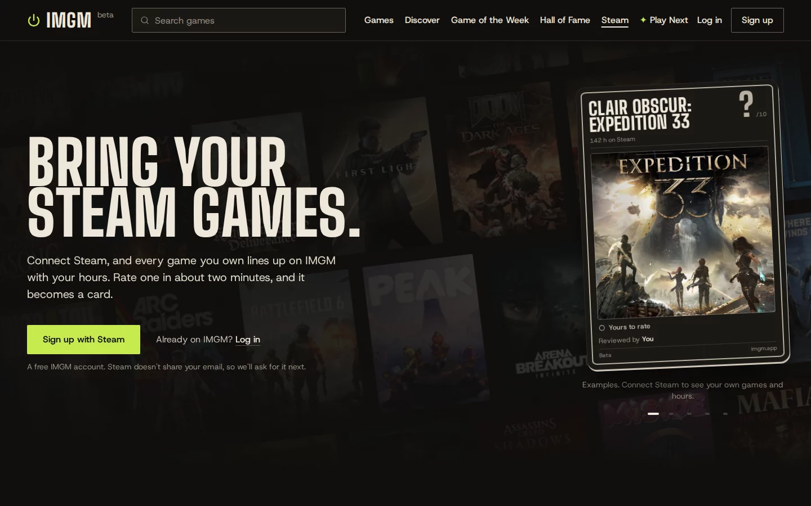<p align="center"><b>Steam</b>: log in with Steam, and every game you own lines up with your hours, ready to rate.</p></td>
  </tr>
</table>

Plus a **community**: follow players and see how much your taste matches theirs (or send a friend a compare link), collect **card sets** (a studio's games, a series, the Game of the Year nominees), and a game's first review becomes a **First Edition** card with a crown of gems. A **bell** for replies and backlog releases, opt-in emails, a **backlog** for later, **player profiles** with levels and badges, and helpful votes on reviews.

---

## Under the hood


| Part | Stack | Runs on |
|---|---|---|
| [`imgm-client`](imgm-client) | React 19, Vite, Tailwind 4, React Router 7, lucide-react, hls.js | Vercel |
| [`imgm-server`](imgm-server) | Express 5, Prisma 7, Zod 4, Better Auth, express-rate-limit | Render |
| [`imgm-ai`](imgm-ai) | Python 3.12, FastAPI, LangGraph, LangChain, uv | Google Cloud Run |
| Database | PostgreSQL with pgvector | Neon |

<details>
<summary><b>Problems worth reading about</b></summary>

<br>

**Making an AI agent follow the rules**

- **The prompt asks, the code enforces.** A model will happily recommend a game you've already played, one that isn't on your console, or the very game you asked about. So every hard rule is plain Python in [`check_answer()`](imgm-ai/src/imgm_ai/agent/nodes.py), which reads the real search results and sends a broken answer back with the exact problems, up to two rounds. The player never saw that draft, so the fixed answer is told to read as a first answer, never *"I swapped out…"*.
- **It missed the obvious next game.** Asked for games like *It Takes Two*, the agent never found *Split Fiction*, the same studio's 2025 game: it was newer than the model, and a "sequel" web search came back with noise. Now a tool asks IGDB for the game's series and its studio's other games, keeping a studio game only if it shares a genre *and* a game mode (FromSoftware also made a Hello Kitty game). The check then allows one game from the series and three from the whole family, so the other picks are discoveries.
- **Your Steam library, your rules.** The Steam menu's choices ride in the graph's config, out of the model's reach, and a single function (`steam_may_suggest`) decides which library games may be picks: the tool uses it to tell the model, the check uses it to enforce. When what the model is told and what the code checks come from one place, they can't drift apart.
- **Quotes that can't be made up.** The daily game's line from the game: ask a model for a famous quote and you get a confident misquote. So Gemini suggests a few lines (names blanked), and a web search keeps one only if a real page has its longest stretch word for word. In a test it got 9 of 10 famous games right, and the check caught the tenth, a reworded *Last of Us* line. Swearing stays, starred but readable.
- **Your id is never the model's to choose.** The tools read the player from LangGraph's config, which the model can't see or set, so no prompt injection can open someone else's reviews.
- **What the model never sees, it can't repeat.** Swearing in review quotes is masked before the agent reads them, so it can't quote it back to you.
- **AI summaries that can't make things up.** A game's *what players think* block gets its facts from code (counts, majority answers); the model only writes the words, and a theme survives only if two real reviews back it. A broken answer gets one retry with the exact problems, and if that fails too the old summary stays.

**Running on other people's servers**

- **Two Googles that reject each other's work.** Gemini 3 signs every tool call it makes, and Vertex AI and AI Studio each refuse the other's signatures (*"Invalid thought signature"*). When the fallback chain switches system in the middle of an answer, every message remembers which one wrote it, and the other's signatures are removed before it's sent.
- **A minute of silence.** A Vertex call once took the request and never answered: the player waited out a 60-second timeout, and the backup model then did the same job in 4.5 seconds. Each job now has its own limit (25s to build the cards, 15s to route a message), and a model that fails is skipped for a while instead of being tried again by every call.
- **Every agent shares Google's address.** Play Next's agent calls the API from Cloud Run, so a limit per IP address would have been one limit for every player. Limits count per player instead: the agent's requests carry the player's id, trusted only with a shared secret.
- **IGDB search ranks by spelling.** IGDB orders search results by text match only, so *"hades"* came back with a 1995 shooter before Supergiant's Hades. The server re-ranks them by popularity on a log scale, plus a bonus for an exact title, so the famous game wins without drowning out the right one.

**Video on phones**

- **Trailers without YouTube's ads.** Discover asks Steam's Web API for a whole feed's trailers in one request (asking per game got Render's address turned away), and Microsoft's store catalog for games that aren't on Steam. Both stream HLS from their own servers.
- **iPhones and video.** Safari starts a stream on the first quality it's listed with, and Steam lists 1080p first, so the server serves a copy of the playlist with 480p first (the video still comes from Steam). An iPhone loads nothing until `play()`, and only plays sound from a `<video>` a tap once started: Discover starts every trailer at once, and keeps four shared players that the first tap unlocks.
- **Smooth on a phone.** Only the games next to the one on screen are drawn in full, and the next trailer loads in advance, so a swipe starts it in about 0.15s.

**Accounts and community**

- **Steam login without a Steam SDK.** Steam speaks OpenID 2.0, which Better Auth doesn't, so [`steamAuth.js`](imgm-server/src/lib/steamAuth.js) is a Better Auth plugin written for it: connect, log in, sign up (Steam gives no email, so it asks for one) and disconnect, with every check on Steam's answer in one place.
- **One login limit for the whole site.** A security check before launch found that, behind Vercel and Render, the login library saw several proxy addresses on every request, gave up on finding the visitor's, and kept one bucket for everyone: three logins per 10 seconds for the whole site. Every limit now counts the visitor's real address (the first one in the forwarding header, which Vercel always sets), and logins, sign-ups and reset emails are also limited per email, so faking an address calling the server directly doesn't help.
- **Signing up with someone else's email.** An unconfirmed account made with your email would have blocked your Google login, or kept its password after you linked Google (account pre-hijacking). Now a Google login with a confirmed email takes the account over clean: the stranger's password, sessions and Steam go.
- **No starting over once you know the answer.** The daily game is kept per browser in a signed cookie as well as the page's storage, so logging out or clearing one of them shows the finished game, not a fresh one. Each account still starts the day clean.
- **Comments that stay civil.** Links, slurs and "kys" are refused after folding l33t speak and accents, by whole words, so Scunthorpe still gets through.

</details>

<details>
<summary><b>The repository</b></summary>

<br>

```text
imgm.app/
├── imgm-client/        the website (React)
│   └── src/
│       ├── pages/          one file per page: Home, Discover, GameDetails, ReviewQuest…
│       ├── components/     cards, the review quest's screens, Discover, the home page…
│       └── lib/            the API client, rarity, buttons and other shared pieces
├── imgm-server/        the API (Express)
│   ├── prisma/             the database schema and migrations
│   └── src/
│       ├── routes/  controllers/   the endpoints
│       ├── services/       IGDB, Steam, Xbox, trailers, email
│       └── lib/            auth, Steam login, the comment filter, config
├── imgm-ai/            Play Next (Python)
│   └── src/imgm_ai/
│       ├── agent/          the graph: nodes, prompts, schemas, tools
│       └── models/         the model chain (Ollama locally, Gemini in production)
└── docker-compose.yml  Postgres, the server and the client, for local work
```

</details>

## Run it locally

You'll need **Docker**, and for Play Next, **Python 3.12** with [uv](https://docs.astral.sh/uv/).

```bash
git clone https://github.com/Maorophir/imgm.app.git
cd imgm.app

# Settings: copy each example and fill it in (IGDB needs a free Twitch app)
cp imgm-server/.env.example imgm-server/.env
cp imgm-ai/.env.example imgm-ai/.env

# Postgres on :5432, the server on :5000, the website on http://localhost:5173
docker compose up -d
```

The server runs its database migrations on every start. Play Next runs on your own machine:

```bash
cd imgm-ai
uv run uvicorn imgm_ai.server:app --host 0.0.0.0 --port 8000
```

Locally it can use [Ollama](https://ollama.com) (`LLM_PROVIDER=ollama`, free and slow: good for "does it work") or Gemini (`LLM_PROVIDER=gemini`).

| Where | Command |
|---|---|
| `imgm-client` | `npm run lint` · `npx vite build` |
| `imgm-server` | `docker exec imgm-server npx prisma migrate dev --name <name>` for a new migration |

## Credits

- **Design:** the "Noir" look is by **roiegold**.
- **Game data:** [IGDB](https://www.igdb.com). **Trailers:** Steam and Xbox, played from their own servers, and YouTube.
- **Quotes:** checked with a [Tavily](https://tavily.com) web search, or from [Wikiquote](https://en.wikiquote.org). **Visitor countries:** [IP2Location LITE](https://lite.ip2location.com).
- Built by **Maorophir**, one developer, as a public beta. Feedback is welcome on the site (the Feedback button) or in an issue.

## License

Copyright © 2026 Maorophir. The code is public so you can learn from it, under the [PolyForm Noncommercial License 1.0.0](LICENSE.md):

- You may read it and use it for **non-commercial** purposes (learning, personal projects), as long as you **keep the copyright notice and credit IMGM**.
- **Commercial use is not allowed** without written permission. Want to use it commercially? Get in touch.
- The IMGM name and logo are not covered by the license.
