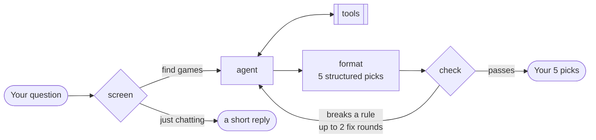
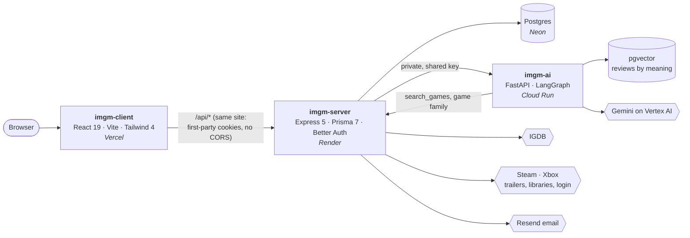

<p align="center">
  <a href="https://imgm.app"></a>
</p>

<h3 align="center">Play it. Rate it. Collect it.</h3>

<p align="center">
  A game review site where every review is a quick quest, every score is loot,<br>
  and an AI agent picks the next five games you'll actually want to play.
</p>

<p align="center">
  <a href="https://imgm.app"></a>
  
  <a href="LICENSE.md"></a>
</p>

<p align="center">
  
  
  
  
  
  
  
  
  
</p>

<p align="center">
  <a href="#rate-a-game-in-two-minutes">Features</a> ·
  <a href="#play-next-the-ai-agent">Play Next</a> ·
  <a href="#under-the-hood">Under the hood</a> ·
  <a href="#run-it-locally">Run it locally</a>
</p>

---

## Rate a game in two minutes

<table>
  <tr>
    <td width="40%" align="center"></td>
    <td>
      <p>A review on IMGM isn't a form. It's a <b>quest</b>: up to nine quick screens, every one skippable.</p>
      <ul>
        <li><b>Your rating:</b> tap or drag across ten stars.</li>
        <li><b>Your setup:</b> platform, hours, finished or still playing, solo or co-op.</li>
        <li><b>The vibe:</b> cozy, chaotic, atmospheric, rage-inducing…</li>
        <li><b>When did it get good?</b> Instantly, or after many hours.</li>
        <li><b>The checklist:</b> graphics, gameplay, audio, story, difficulty, grind, length, PC specs, price, in plain words like <i>"One more match" (it's 4 AM)</i>.</li>
        <li><b>It's like ___ meets ___</b>, pros and cons, best and worst moment, and final words.</li>
      </ul>
      <p>Every screen earns XP toward your level, and reviews unlock badges. In a hurry? <b>Quick review</b> is just the score.</p>
    </td>
  </tr>
</table>

## Every rating becomes a collectible card

<table>
  <tr>
    <td>
      <p>Your score sets the card's <b>rarity</b>, from a grey Junk card to a gold Legendary one:</p>
      <p></p>
      <ul>
        <li>The card tilts toward your pointer, with a soft glare across it.</li>
        <li><b>Flip it</b> and its back is <b>the verdict</b>: every checklist answer on a meter in the rarity colours.</li>
        <li>Pick the art from the game's covers and screenshots, then <b>share</b> it as a picture.</li>
        <li>A game's IMGM score is its players' average, with the same rarity.</li>
      </ul>
    </td>
    <td width="40%" align="center"></td>
  </tr>
</table>

## Discover: what's hot and what's coming, trailer by trailer

<table>
  <tr>
    <td width="40%" align="center"></td>
    <td>
      <p>A feed like the ones on your phone, but every screen is a game. <b>Hot Now</b> is the most visited games of the last two years; <b>Upcoming</b> is the most wanted games of the next year, ranked by IGDB's popularity data.</p>
      <ul>
        <li><b>Trailers without ads:</b> streamed from Steam's own video servers, then Xbox's, and YouTube only as the last resort.</li>
        <li>Thumbs up or down, <b>comments</b> with replies and likes, <b>Want it</b> for your backlog, and <b>Played it?</b> for a one-tap score.</li>
        <li>Sound like Reels: it starts muted, and one tap turns it on for the whole feed.</li>
        <li>Built for phones: square trailers upright, full screen on its side.</li>
      </ul>
    </td>
  </tr>
</table>

<p align="center"></p>

## Play Next: the AI agent

Tell Play Next what you're in the mood for (*"something cozy for a rainy evening"*, *"games like Hades but longer"*) and it picks **five games for you**. It reads your own reviews and what IMGM players say about each game, and it checks its own answer before you see it.

It's a **LangGraph** agent in Python, with its own tools:



| Tool | What it does |
|---|---|
| `get_my_taste` | Your reviews: what you loved, what you didn't, the vibes you pick. |
| `search_imgm_reviews` | Searches every IMGM review by meaning (RAG over **pgvector**). |
| `search_games` | Searches IGDB's catalogue through the IMGM server. |
| `get_game_profile` | One game in depth: genres, modes, length, IMGM score. |
| `get_game_family` | A game's series and its studio's similar games, so new releases aren't missed. |
| `search_web` | A web search (Tavily) for what's too new for the rest, at most twice an answer. |

**The prompt asks, the code enforces.** Every hard rule lives in plain Python in [`check_answer()`](imgm-ai/src/imgm_ai/agent/nodes.py): five different games, each one found by a real search, nothing you've already reviewed or turned down, playable on your platforms, no longer than you asked for, never the game you named, at most one from its series, and exactly one Best Pick. A broken rule sends the draft back to the agent to fix. The agent never sees your user id as something it could change: its tools read it from the graph's config, so a prompt injection can't make it look at someone else's reviews.

Then you **sort your picks**: mark the ones you've played or don't want, and one search replaces them all.

## And the rest of IMGM

<table>
  <tr>
    <td width="50%"><p align="center"><b>Game pages</b>: trailers and screenshots, the IMGM score, an AI summary of what players praise and criticize, and where to buy.</p></td>
    <td width="50%"><p align="center"><b>Hall of Fame</b>: the best-rated games on IMGM, by platform.</p></td>
  </tr>
  <tr>
    <td width="50%"><p align="center"><b>Game of the Week</b>: chosen by the community every week.</p></td>
    <td width="50%"><p align="center"><b>Steam</b>: log in with Steam, and every game you own lines up with your hours, ready to rate.</p></td>
  </tr>
</table>

Plus a **backlog** for later, **player profiles** with levels and badges, and helpful votes on reviews.

---

## Under the hood



| Part | Stack | Runs on |
|---|---|---|
| [`imgm-client`](imgm-client) | React 19, Vite, Tailwind 4, React Router 7, lucide-react, hls.js | Vercel |
| [`imgm-server`](imgm-server) | Express 5, Prisma 7, Zod 4, Better Auth, express-rate-limit | Render |
| [`imgm-ai`](imgm-ai) | Python 3.12, FastAPI, LangGraph, LangChain, uv | Google Cloud Run |
| Database | PostgreSQL with pgvector | Neon |

<details>
<summary><b>A few problems worth reading about</b></summary>

<br>

- **Steam login without a Steam SDK.** Steam speaks OpenID 2.0, which Better Auth doesn't, so [`steamAuth.js`](imgm-server/src/lib/steamAuth.js) is a Better Auth plugin written for it: connect, log in, sign up (Steam gives no email, so it asks for one), and disconnect. Every check on Steam's answer is in one place.
- **Trailers without YouTube's ads.** Discover asks Steam's Web API for a whole feed's trailers in one request (one request per game got Render's address turned away), and Microsoft's store catalog for games that aren't on Steam. Both stream HLS from their own servers.
- **iPhones and video.** Safari starts a stream on the first quality it's listed with, and Steam lists 1080p first: the server serves a copy of the playlist with 480p first (the video still comes from Steam). An iPhone loads nothing until `play()`, and only plays sound from a `<video>` a tap once started: Discover starts every trailer at once and keeps four shared players that the first tap unlocks.
- **Smooth on a phone.** Only the games next to the one on screen are drawn in full, and the next trailer loads in advance, so a swipe starts it in about 0.15s.
- **Comments that stay civil.** Links, slurs and "kys" are refused after folding l33t speak and accents, by whole words, so Scunthorpe still gets through.
- **AI that fails over.** Gemini runs as a chain (Vertex AI first, then a paid key), each job with its own timeout, and a model that fails is skipped for a while.

</details>

<details>
<summary><b>The repository</b></summary>

<br>

```text
imgm.app/
├── imgm-client/        the website (React)
│   └── src/
│       ├── pages/          one file per page: Home, Discover, GameDetails, ReviewQuest…
│       ├── components/     cards, the review quest's screens, Discover, the home page…
│       └── lib/            the API client, rarity, buttons and other shared pieces
├── imgm-server/        the API (Express)
│   ├── prisma/             the database schema and migrations
│   └── src/
│       ├── routes/  controllers/   the endpoints
│       ├── services/       IGDB, Steam, Xbox, trailers, email
│       └── lib/            auth, Steam login, the comment filter, config
├── imgm-ai/            Play Next (Python)
│   └── src/imgm_ai/
│       ├── agent/          the graph: nodes, prompts, schemas, tools
│       └── models/         the model chain (Ollama locally, Gemini in production)
└── docker-compose.yml  Postgres, the server and the client, for local work
```

</details>

## Run it locally

You'll need **Docker**, and for Play Next, **Python 3.12** with [uv](https://docs.astral.sh/uv/).

```bash
git clone https://github.com/Maorophir/imgm.app.git
cd imgm.app

# Settings: copy each example and fill it in (IGDB needs a free Twitch app)
cp imgm-server/.env.example imgm-server/.env
cp imgm-ai/.env.example imgm-ai/.env

# Postgres on :5432, the server on :5000, the website on http://localhost:5173
docker compose up -d
```

The server runs its database migrations on every start. Play Next runs on your own machine:

```bash
cd imgm-ai
uv run uvicorn imgm_ai.server:app --host 0.0.0.0 --port 8000
```

Locally it can use [Ollama](https://ollama.com) (`LLM_PROVIDER=ollama`, free and slow: good for "does it work") or Gemini (`LLM_PROVIDER=gemini`).

| Where | Command |
|---|---|
| `imgm-client` | `npm run lint` · `npx vite build` |
| `imgm-server` | `docker exec imgm-server npx prisma migrate dev --name <name>` for a new migration |

## Credits

- **Design:** the "Noir" look is by **roiegold**.
- **Game data:** [IGDB](https://www.igdb.com). **Trailers:** Steam and Xbox, played from their own servers, and YouTube.
- Built by **Maorophir**, one developer, as a public beta. Feedback is welcome on the site (the Feedback button) or in an issue.

## License

Copyright © 2026 Maorophir. The code is public so you can learn from it, under the [PolyForm Noncommercial License 1.0.0](LICENSE.md):

- You may read it and use it for **non-commercial** purposes (learning, personal projects), as long as you **keep the copyright notice and credit IMGM**.
- **Commercial use is not allowed** without written permission. Want to use it commercially? Get in touch.
- The IMGM name and logo are not covered by the license.
